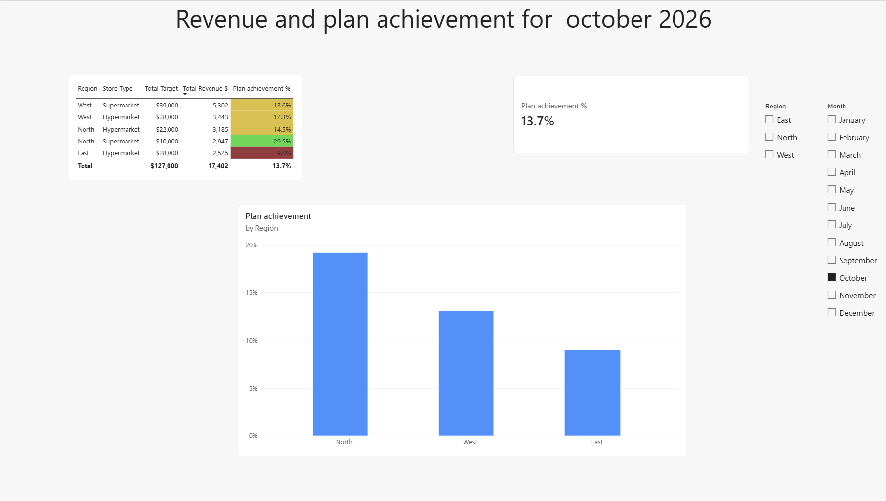

# Power BI: Sales vs. Plan (October 2026)

## Objective
This report shows revenue and plan achievement for October 2026.
It helps regional managers see which stores meet their sales target and which ones are falling behind.

## Data
Training dataset (Excel) with four tables:
- **Sales** – 300 order lines, October 2026
- **Stores** – 6 stores in 3 regions
- **Products** – 15 products in 6 categories
- **Targets** – monthly sales targets per store, 2026

## Data preparation (Power Query)
| Issue | Fix |
|---|---|
| Dates in Slovak format (dd.mm.yyyy) | Change Type Using Locale |
| Numbers stored as text | Changed data types |
| Missing targets marked with "-" | Replaced with null |
| Targets in wide format (one column per month) | Unpivot Other Columns |
| Targets stored in thousands EUR (stated in the sheet header)| Multiplied by 1,000 to convert to EUR|
| No revenue column | Calculated: Qty × Unit Price × (1 − Discount) |
| Duplicate orders | Removed duplicates after cleaning |

## Data model
Star schema with one-to-many relationships:
- **Fact tables:** Sales, Targets
- **Dimensions:** Stores, Products, Calendar

Sales and Targets are not connected directly because they have a different grain:
Sales has one row per order line, Targets has one row per store per month.
They are connected through shared dimensions – **Stores** and **Calendar**.
The Calendar table (built with DAX `CALENDAR()`) lets one month slicer filter both sales and targets.

## DAX measures
| Measure | Formula | Purpose |
|---|---|---|
| Total Revenue | `SUM(Sales[Revenue])` | Actual sales |
| Total Target | `SUM(Targets[Target])` | Sales plan |
| Plan Achievement % | `DIVIDE([Total Revenue], [Total Target])` | Actual vs. plan (DIVIDE avoids division by zero) |
| Total Revenue All | `CALCULATE([Total Revenue], ALL(Stores))` | Company total, ignores store/region filters |
| Revenue Share % | `DIVIDE([Total Revenue], [Total Revenue All])` | Share of each region in total revenue |

## Key findings
- **Supermarket North** has the best plan achievement, but even it reached only **29.5%** of its target.
- **Hypermarket East** is the weakest store with **9.0%**.
- By region, **North** performs best (**19.2%**), East is the weakest.
- Total plan achievement is only **13.7%**.

**Data caveat:** Target units (thousands EUR) are confirmed by the source, so the low plan achievement is most likely caused by incomplete sales data (only 300 order lines for 6 stores per month). Recommendation: check with the data owner whether the sales export is complete.

## Dashboard

Conditional formatting: red < 10%, yellow 10–20%, green ≥ 20% of target.

## Tools
Power BI Desktop · Power Query · DAX
